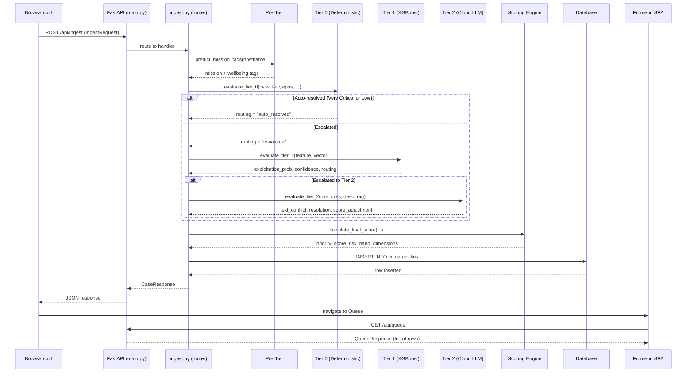

# Chapter 2: Architecture Overview

**Target:** 1500–3000 words · Self-contained · Podcast-script style

---

So you've read Chapter 1 — you know *why* TriageMate exists. Now let's pop the hood and look at how it's wired together. Grab a coffee; this is the chapter where it all clicks.

---

## The Big Picture

TriageMate is a monolithic Python backend driven by FastAPI, backed by a single SQLite database (with a PostgreSQL compatibility layer for when you grow up), and fronted by a zero-build-step static HTML/JS single-page application. No microservices. No message queues. No Kubernetes. Just one `main.py`, one `database.py`, some router modules, and a `frontend/` directory you can serve with `python -m http.server`.

The design philosophy is intentional: **a security team's triage tool should be *deployable* by one person in five minutes, not require a DevOps degree.** You clone the repo, install the deps, run `uvicorn main:app`, and you're ingesting vulnerabilities. That simplicity is a feature, not a shortcut.

### Why Monolithic?

Microservices are great when you have multiple teams owning different concerns. TriageMate has one concern — triage — and one operator — you. Monolithic means:

- **One process to monitor.** No distributed tracing, no service mesh, no dance.
- **One database to back up.**
- **Atomic deployment.** The entire system is a single git pull and a process restart.
- **Lazy-loaded ML models.** XGBoost and SentenceTransformer models live in memory inside the same process. They load on first inference, not at startup. This keeps cold starts under 1 second.

The trade-off is that you can't scale the ML and API independently. For a tool that processes maybe a few thousand vulns a day in a small-to-medium SOC, that's irrelevant.

---

## The Four-Tier Pipeline

The heart of TriageMate is a processing pipeline with four tiers. Each tier represents a different *cost-to-accuracy* trade-off. The idea is simple: spend cheap cycles first, expensive cycles only when necessary.

```
Pre-Tier (Mission Classification) → Tier 0 (Deterministic Rules) → Tier 1 (XGBoost ML) → Tier 2 (Cloud LLM)
                                                                                           ↓
                                                                                    Scoring Engine
```

### Pre-Tier: Mission Classification

Before we even look at CVSS or CVE, the Pre-Tier asks one question: **does this asset matter?**

It takes the hostname (or IP, or asset tag) from the ingest payload and runs it through a lightweight classification model (currently a SentenceTransformer + logistic regression head, trained on a labelled corpus of hostname patterns). It returns two tags:

- **Mission Criticality:** `mission_critical`, `mission_support`, or `standard`
- **Wellbeing Impact:** `wellbeing_critical`, `wellbeing_support`, or `none`

These tags feed into every subsequent tier. A `mission_critical` host with a CVSS 5.0 vuln can outrank a `standard` host with a CVSS 7.5. That's intentional — not all assets are equal.

### Tier 0: Deterministic SSVC-Aligned Rules

Tier 0 is a set of hand-crafted, deterministic rules inspired by the [SSVC (Stakeholder-Specific Vulnerability Categorization)](https://www.cisa.gov/ssvc) framework. No ML. No API calls. Pure boolean logic over structured data.

**Inputs:**
- CVSS base score (and vector)
- CISA KEV status
- EPSS percentile (substituted at ingest time if EPSS isn't in the payload)
- CWE category
- Pre-Tier mission/wellbeing tags
- Exploitation status (`none`, `poc`, `active`)
- Automatable flag
- Public impact knowledge

**Outcomes:**
- **Very Critical** → auto-resolved (immediate remediation priority, no further triage needed)
- **Low** → auto-resolved (no action required, period re-check only)
- **Medium** → escalated to Tier 1
- **High** → escalated to Tier 1 (and likely Tier 2)

These rules are in `triage_engine.py` and are the most-tested part of the codebase. Every rule has a unit test. Every combination of inputs maps to a routing decision.

### Tier 1: XGBoost ML

If Tier 0 says "I'm not sure, escalate," we promote to Tier 1. This is a gradient-boosted decision tree model (XGBoost) trained on historical triage decisions.

**Input:** The full 42-key feature vector (more on this immutable contract below).
**Output:**
- `exploitation_prob` (float 0–1): how likely the vuln is to be exploited
- `confidence` (float 0–1): model's confidence in its prediction
- `routing` (string): `resolved`, `escalated_to_tier2`

The model was trained on ~15k labelled vulns from a blend of public CVE datasets, simulated SOC triage logs, and synthetic edge cases. The decision threshold was tuned to minimise false negatives (vulns that should be escalated but aren't) at the cost of some false positives.

**Boundary check:** If the model's confidence is below 0.3, the prediction is discarded and the vuln is automatically escalated to Tier 2. This is the "I don't know what I don't know" safety valve.

### Tier 2: Cloud LLM

Tier 2 is the heaviest hammer. If Tier 1 says "escalated" (or can't decide), we build a prompt and send it to a cloud LLM (default: OpenAI GPT-4o-mini or Anthropic Claude Haiku, configurable via env var).

The prompt includes:
- CVE description
- CVSS vector and score
- CWE classification
- EPSS + KEV status
- RAG context (if available — we query a local LanceDB vector store for similar past vulns and their resolutions)
- Pre-Tier mission/wellbeing tags

**Output:**
- `text_conflict` (bool): whether the LLM found contradictory information in the RAG results
- `resolution` (string): free-text rationale
- `score_adjustment` (float): an integer adjustment to the priority score (±2)

The LLM doesn't make the final decision — that's the Scoring Engine's job. The LLM is an *advisor*, not a *judge*. This is deliberate: we want the deterministic scoring to be the source of truth, with the LLM providing context-aware adjustments.

### Scoring Engine

The Scoring Engine (`scoring_engine.py`) takes outputs from all four tiers and produces a single unified score.

**Scoring dimensions:**
- **Exploitation Likelihood** (0–100): weighted from Tier 1's `exploitation_prob`, adjusted by Tier 2's score_adjustment
- **Business Impact** (0–100): derived from Pre-Tier mission tags + CVSS impact sub-score
- **Environmental Context** (0–100): from CVSS modified base metrics + asset criticality
- **Urgency** (0–100): from KEV status, active exploitation, and Tier 0 rules
- **Triage Confidence** (0–100): how much the system trusts its own score

**Output:**
- `priority_score` (0–1000): weighted sum of all dimensions
- `risk_band`: `critical` (≥750), `high` (≥500), `medium` (≥250), `low` (≥100), `informational` (<100)
- `dimension_scores`: the raw per-dimension breakdown

---

## The 42-Key Feature Vector Contract

Somewhere between Tier 0 and Tier 1, the pipeline calls `build_feature_vector()`. This function takes the ingested vuln + all Tier 0 enrichments and produces a flat dictionary of **exactly 42 keys**.

**The rule:** once a key is released, it is never renamed or removed. Only appended.

Why? Because the XGBoost model expects fixed-dimension input. If you rename or remove a feature, all existing model files break. The only safe operation is appending new features to the end of the vector — then you retrain the model, and the new model expects the new dimensionality.

This contract is enforced by the `feature-vector-spec` skill in `.opencode/skills/`. Any code that modifies the feature vector must pass a spec check.

---

## Request Flow: From Ingest to Response

Let's trace a single vuln through the system. The sequence diagram below captures the full journey:



1. **Client sends** `POST /api/ingest` with an `IngestRequest` body (CVE, hostname, CVSS, etc.).
2. **main.py** routes to the `ingest.py` handler. First thing we do is schema validation via Pydantic — malformed payloads get 422 before they touch any tier.
3. **CWE classification** runs locally (a lookup table + SentenceTransformer fallback for unknowns).
4. **EPSS substitution** — if the payload lacks EPSS data, we look it up from a precomputed local table via CVE.
5. **Pre-Tier** classifies the asset's mission importance.
6. **Tier 0** applies deterministic rules. If the result is `auto_resolved` (Very Critical or Low), we skip straight to scoring.
7. **Tier 1** (if escalated) builds the feature vector and runs XGBoost inference.
8. **Tier 2** (if Tier 1 escalated) queries RAG context from LanceDB, builds a prompt, calls the LLM, parses the response.
9. **Scoring Engine** takes everything and computes the final score.
10. **DB insert** — the entire result, including all intermediate decisions, is stored in the `vulnerabilities` table.
11. **Response** — the client gets back a `CaseResponse` with score, risk band, and routing path.
12. **Frontend** — when the user opens the queue view, it calls `GET /api/queue` to fetch the latest rows.

---

## Router Structure

`main.py` mounts four routers, each in its own file under `backend/routers/`:

### `auth.py` — Authentication

- `POST /api/auth/login` — takes username/password, returns JWT access + refresh tokens
- `POST /api/auth/refresh` — takes refresh token, returns new access token
- Auth is optional (controlled by env var `AUTH_ENABLED`). In single-user mode, you can skip it entirely.

### `queue.py` — Queue Management

- `GET /api/queue` — returns paginated, filterable list of vulns
- `GET /api/queue/metrics` — aggregate stats (count by risk band, average score, etc.)
- `GET /api/queue/drift` — model drift metrics (compares recent Tier 1 predictions against actual outcomes)
- `GET /api/queue/export` — CSV export of the queue

### `cases.py` — Case Operations

- `GET /api/cases/{id}` — full detail for one vuln
- `POST /api/cases/{id}/notes` — add analyst notes
- `POST /api/cases/{id}/review` — mark as reviewed, update disposition
- `POST /api/cases/{id}/reclassify` — override the risk band

### `ingest.py` — Ingestion Endpoints

- `POST /api/ingest` — single vuln ingest (the main pipeline entry point)
- `POST /api/ingest/batch` — batch ingest (up to 100 at once, processed sequentially)
- `POST /api/ingest/tenable` — Tenable-specific import format (parses Tenable CSV/JSON → normalised IngestRequest)
- `POST /api/ingest/demo` — seeds the database with realistic demo data (for eval/training)

---

## Middleware Stack

FastAPI middleware runs on every request, top-down:

| Middleware | Description | Config |
|---|---|---|
| **CORS** | Wide-open for MVP (`Access-Control-Allow-Origin: *`) | Env `CORS_ORIGINS` (defaults to `*`) |
| **Rate Limiting** | Token bucket algorithm, per-path buckets | `RATE_LIMIT_RPM` env var (defaults to 60 req/min per path) |
| **Auth** | JWT Bearer extraction and validation | `AUTH_ENABLED`, `JWT_SECRET` env vars |

The rate limiter is especially important during scanner floods. If a Nessus or Qualys scanner dumps 10,000 vulns in one batch, the token bucket smooths it into a manageable flow. Excess requests get 429 responses — you can retry with exponential backoff on the scanner side.

---

## Background Tasks

TriageMate uses FastAPI's `BackgroundTasks` and a single `asyncio.create_task` loop for recurring work.

### Daily Low-Severity Re-Check

Every 86400 seconds (24 hours), a background task selects all rows where:
- `risk_band = 'low'`
- `last_rechecked < now() - interval '7 days'`
- `status = 'open'`

It re-runs Tier 0 on each of these stale rows. The idea is that a vuln that was low last week might have a new KEV entry, a higher EPSS percentile, or updated exploitation data. The re-check catches that without analyst effort.

### 7.5% Audit Sampling

A separate task randomly selects 7.5% of all *non-resolved* rows and flags them for audit review. An analyst can filter the queue to show only audit-flagged items. This provides a statistical basis for measuring the pipeline's accuracy over time.

---

## Startup Lifecycle

When you start the server (`uvicorn main:app`), the boot sequence is:

1. **`.env` loading** — `python-dotenv` reads `.env` from the project root
2. **Logging config** — structured JSON logging for production, pretty console for dev
3. **Database initialisation** — `init_db()` creates tables if they don't exist; Alembic runs any pending migrations
4. **SBERT preload** — SentenceTransformer model is loaded into memory (this is the biggest startup hit, ~1.5s with `all-MiniLM-L6-v2`)
5. **LanceDB initialisation** — vector store is created/connected; seed documents are ingested if empty
6. **Health endpoint** — `GET /api/health` returns `{"status": "ok"}` once the server is ready
7. **Background loop** — the re-check and audit-sampling tasks start their tick loops

The entire process takes about 3 seconds from `uvicorn` to health-check green.

---

## File Map

```
triagemate/
├── backend/
│   ├── main.py                  # FastAPI app, middleware, startup, router mounts
│   ├── database.py              # DB init, raw SQL, _PGCompatRow, _PGCursor, _PGConnection
│   ├── triage_engine.py         # Tier 0 deterministic rules
│   ├── ml_predictor.py          # XGBoost model load + prediction
│   ├── llm_analyzer.py          # Tier 2 LLM prompt builder + response parser
│   ├── scoring_engine.py        # Scoring dimensions + final score computation
│   ├── feature_builder.py       # build_feature_vector() — the 42-key contract
│   ├── mission_classifier.py    # Pre-Tier hostname classifier
│   ├── cwe_classifier.py        # CWE lookup + fallback
│   ├── epss_lookup.py           # EPSS percentile by CVE
│   ├── rag_retriever.py         # LanceDB vector store query
│   ├── sbert_encoder.py         # SentenceTransformer wrapper (lazy-loaded)
│   ├── rate_limiter.py          # Token bucket rate limiter
│   ├── auth.py                  # JWT creation and validation
│   ├── config.py                # Pydantic Settings from env vars
│   └── routers/
│       ├── __init__.py
│       ├── auth.py
│       ├── queue.py
│       ├── cases.py
│       └── ingest.py
├── frontend/
│   ├── index.html               # SPA entry point
│   ├── css/
│   │   └── app.css             # Tailwind-like utility classes (hand-written)
│   └── js/
│       ├── app.js               # Router, state, API client
│       ├── views/
│       │   ├── queue.js         # Queue table view
│       │   ├── case.js          # Case detail view
│       │   ├── metrics.js       # Metrics dashboard
│       │   └── settings.js     # User settings
│       └── components/
│           ├── navbar.js
│           ├── filters.js
│           └── modal.js
└── triagemate-book/
    ├── 01-introduction.md
    ├── 02-architecture-overview.md      # ← you are here
    ├── 03-installation.md
    └── ...
```

---

## Design Rules (The Non-Negotiables)

Three architectural rules govern every pull request:

### 1. Pipeline calls ML, not the other way around

The ingest pipeline (`ingest.py`) orchestrates the entire flow. It calls ML models when it needs them. Models never reach out to the pipeline. This keeps the dependency direction clean and makes each tier independently testable.

### 2. Integrations are independently skippable

Every external integration (EPSS lookup, LLM call, LanceDB query) has:
- A **TTL cache** (configurable per integration, default 5 minutes)
- A **graceful degradation path** (if the call fails, we log the error and continue with a sensible default)
- A **timeout** (no integration blocks the pipeline for more than 15 seconds)

You can remove the OpenAI API key from `.env` and the entire system still works — Tier 2 LLM calls return a no-op adjustment with a score adjustment of 0. The LLM is a *plugin*, not a *requirement*.

### 3. Features are immutable once released

The 42-key feature vector is a contract. Once a feature key lands in a release, it's set in stone. You can add new keys (incrementing the dimensionality), but you can't rename or remove old ones. This is enforced by the `feature-vector-spec` skill and checked in CI.

---

## What's Planned (MVP)

These are on the roadmap but haven't landed yet:

- **Rate limiting via env var** — the rate limiter currently uses a hardcoded default; making it fully configurable via `RATE_LIMIT_RPM` is a one-line change
- **Model rollback** — dated model filenames (`xgb_model_2026-06-01.json`) + a `--rollback YYYY-MM-DD` CLI flag so you can revert to yesterday's model in a pinch
- **Cache freshness in health endpoint** — `GET /api/health` will expose the staleness of each integration's cache (e.g., `{"epss_last_refreshed": "2026-07-03T12:00:00Z", "kev_age_hours": 4}`)
- **Feature-parity guard test** — a test that asserts `build_tabular_features` output keys exactly match the XGBoost model's expected input dimension. This catches feature drift before it hits production

---

## What's Post-MVP (Explicitly NOT Included)

These are intentionally deferred to keep v1 shippable:

- **RBAC** — there's one role (analyst) and one permission level (full). Role-based access comes later.
- **Email/Slack notifications** — no alerting yet. The tool is a *triage dashboard*, not an alert manager.
- **ModernBERT CWE encoder** — the CWE classifier currently uses a simple lookup table. ModernBERT encoding is in the research pipeline.
- **Cloud deployment** — no Helm chart, no Terraform, no Docker Compose (yet). You run it on a VM.
- **HTTPS/TLS** — handled by your reverse proxy (nginx, Caddy, etc.), not by TriageMate itself. See the nginx config in `deploy/` for a reference.

---

## Why This Architecture Works

The four-tier pipeline is the key insight. Most vuln management tools apply the same processing to every vuln — they either use a simple rule engine (fast but dumb) or an LLM on every single vuln (expensive and slow). TriageMate uses cheap, deterministic rules for the 90% of vulns that are obviously critical or obviously noise, and only promotes the uncertain middle to expensive ML and LLM analysis.

The result is that a typical ingest batch of 100 vulns costs about 3 cents in LLM API fees and completes in under 30 seconds — with 100% of vulns getting a defensible, reproducible score.

That's not just architecture. That's *triage*.
